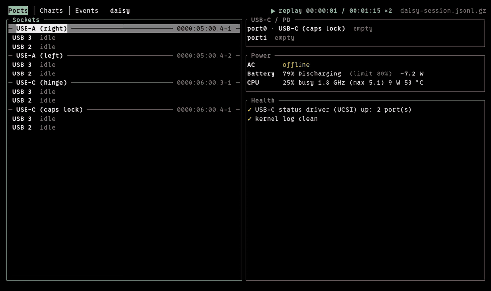
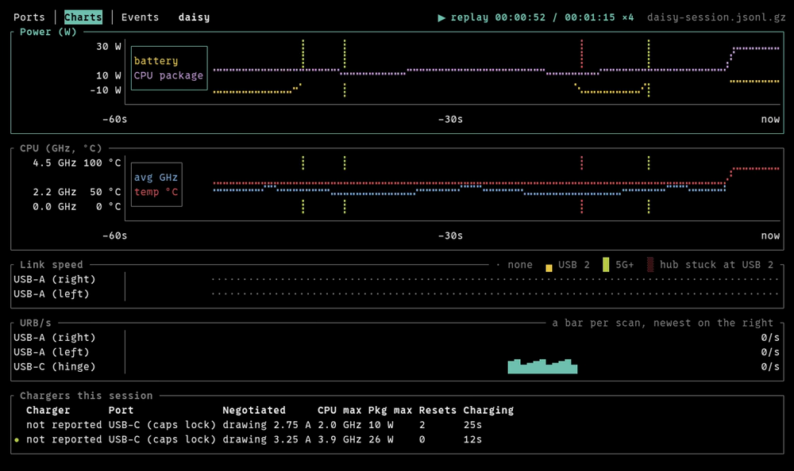

# plugii

A live USB port monitor for Linux. For every physical socket on the machine it
shows what is plugged in and at what link speed, with the USB 2 and USB 3
halves side by side, so a port that has silently fallen back to USB 2 stands
out. It also shows the USB-C / Power Delivery state (partners, offered and
negotiated power), lit DisplayPort / HDMI connectors, Thunderbolt / USB4
authorization, and what the power source lets the CPU do. A one-shot CLI report
ends in a health verdict; a ratatui TUI updates live while you swap hubs,
cables, chargers and devices.





**Status: early development.** The report, health verdict, `--json`, the TUI,
recording and replay, `capture`, `labels` and the `--firmware` checks work.

The full documentation (reading the report, every health check, the TUI,
the keymap) is the docs site in `site/`, to be published at
<https://plugii.dlu.one/>; until then, `mise run docs` serves it
locally. This README is the short version.

## Install

These work from the first release, 0.1.0; until it's out, build from source.

- **Release binaries:** each
  [GitHub release](https://github.com/rdlu/plugii/releases) has
  `plugii-<version>-<target>.tar.gz` for `x86_64-unknown-linux-gnu` and
  `aarch64-unknown-linux-gnu` (glibc 2.35+, libudev), each with a `.sha256`.
  Check it with `sha256sum -c`, then put `plugii` on your `PATH`. The tarball
  also has man pages and bash, zsh and fish completions.
- **mise:** `mise use -g github:rdlu/plugii` installs the release binary.
- **From source** (Rust 1.88+, libudev headers: `libudev-dev` and
  `pkg-config` on Debian/Ubuntu):
  `cargo install --locked --git https://github.com/rdlu/plugii`, or
  `mise run install` in a clone.

The [install page](https://plugii.dlu.one/docs/getting-started/) has the
step-by-step version.

## Commands

```text
plugii                        full report + health; exit 1 if anything is wrong
plugii -H                     health verdict only
plugii --json                 the snapshot and findings as JSON
plugii --firmware             also check BIOS / PD firmware versions (network)
plugii --firmware --refresh   the same, ignoring the day-old catalog cache
plugii watch                  live TUI (also: plugii -w)
plugii watch --record f.jsonl record snapshots while watching
plugii replay f.jsonl         play a recording back
plugii capture <dir>          copy the sysfs files plugii reads, as a test fixture
plugii labels                 list what the labels file names
```

`--firmware` combines with `-H` and `--json`.

## Firmware

`plugii --firmware` adds a Firmware section before Health:

- **BIOS and EC** from DMI (`/sys/class/dmi/id`).
- **The vendor's catalog**, picked by DMI `sys_vendor`:
  - Lenovo: the per-model update catalog
    (`download.lenovo.com/catalog/<MTM>_Win11.xml`) for the latest BIOS
    build and USB-C PD firmware. LVFS doesn't carry these for many
    ThinkPads, so this is the only source.
  - Dell: `CatalogIndexPC.cab` and the per-model catalog for the system ID
    (DMI `product_sku`), which gets BIOS releases before LVFS does. The
    advice says whether fwupd has the update yet.

  Results are cached for a day in `$XDG_CACHE_HOME/plugii/` (default
  `~/.cache/plugii/`); `--refresh` fetches again. Offline is not an error:
  the report says the catalog was unreachable.
- **fwupd** (when `fwupdmgr` is installed): devices an `esrt:` label names,
  with their versions; failed updates; and pending updates from fwupd's
  cached metadata (`fwupdmgr refresh` updates it).

Other vendors get the DMI and fwupd parts.

## Record and replay

`plugii watch --record session.jsonl` runs the TUI as usual and writes every
snapshot to the file (even while the view is paused); the status line shows
`● REC session.jsonl`. A name ending in `.gz` is gzip-compressed. An existing
file is left alone unless you add `--force`. `--redact` replaces device
serial numbers and Thunderbolt unique IDs with `REDACTED`, for recordings you
share.

`plugii replay session.jsonl [--speed N]` plays it back in the same TUI, with
the recorded times on events and charts. `p` pauses, `+` / `-` step the speed
through ×1 ×2 ×4 ×10 ×30 ×60, and `]` / `[` jump to the next / previous plug
or unplug. Labels can't be edited in a replay: it shows the labels as they
were.

The file is JSON lines: a header, then a full snapshot whenever something
changes and a small tick (CPU, power, URB counters) otherwise, with a full
snapshot at least every 10 minutes. Each line is flushed as it's written, so
after a crash the file still plays up to its last line.

## Labels

The kernel can't tell which socket on the chassis a root port is, so names
come from a labels file: `$XDG_CONFIG_HOME/plugii/labels` (default
`~/.config/plugii/labels`). One entry per line; blank lines and `#` comments
are ignored, and the last line for a key wins.

```text
# <pci-address>-<port>  <label>
0000:06:00.4-1  USB-C (caps lock)

# typec:<portN>  <label>  (a UCSI port; same label as its socket)
typec:port0  USB-C (caps lock)

# esrt:<guid>  <label>  (firmware fwupd lists only as "UEFI Device Firmware")
esrt:a77b326c-...  USB-C PD firmware

# peer:<usb2-key>  <usb3-key>  (pair the halves where firmware has no peer link)
peer:0000:00:14.0-1  0000:00:0d.0-1

# device:<vid>:<pid>  <name>  (every device with these ids)
device:05e3:0610  USB switch (desk)
```

- **Sockets:** find the key by plugging something in and reading the unlabeled
  line it appears on. The key is the USB 2 root port's
  `<pci-address>-<port>`.
- **USB-C ports:** plug something into the socket, see which `portN` gains a
  partner, and give it the socket's label. That ties the UCSI port to the
  socket, so a device that carries no USB data (a monitor in DP alt mode)
  still shows on it.
- **Firmware:** an ESRT GUID gets a readable name the same way.
- **Peers:** the USB 2 and USB 3 halves of a socket are paired by the kernel's
  `peer` link when firmware describes it. Where it doesn't (the Dell XPS
  9320's Thunderbolt ports, for one), pair them by hand: plug a USB 3 device
  in; the USB 3 key is its SuperSpeed root port's `<pci-address>-<port>`,
  which on Intel matches the USB 2 one by port number.
- **Devices:** a name for a vid:pid, shown in place of the product string in
  the report and the TUI. A labelled hub coming or going is one event:
  `− USB switch (desk): 6 devices left`.

In `plugii watch`, `L` on the Ports tab names the selected socket or device
and writes it to `~/.config/plugii/labels` (creating it if needed): the last
line for that key is replaced in place, else a line is appended; comments and
order are kept. An empty name removes the key's lines. Relabelling a socket
renames the `typec:` line that carried its old label too.

## License

MIT, see [LICENSE](LICENSE).
